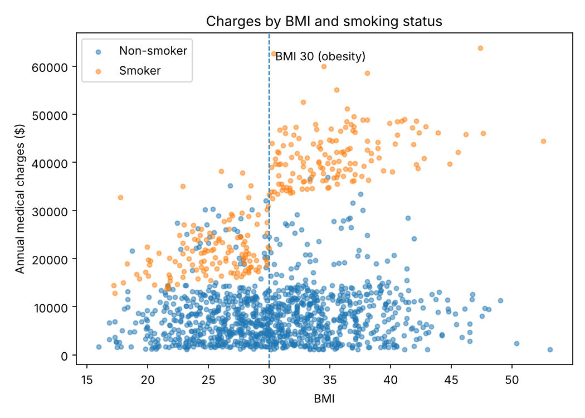
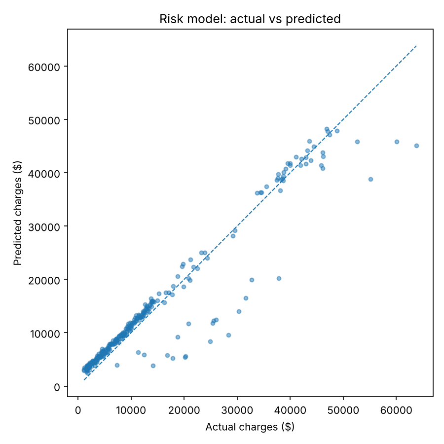

# Insurance Cost Prediction

A Python project that predicts a customer's annual medical insurance charges from basic information (age, BMI, number of children, smoking status, sex and region), and shows which risk factors drive cost the most.

## The problem

Insurers have to estimate what a customer will cost before they price a policy. A simple model that only adds up each factor separately misses an important pattern: smoking costs far more when the person is also obese. This project measures how much a model improves when it is given that risk knowledge.

## Results

Trained on 1,069 customers and tested on 268 customers the model never saw (random 80/20 split, seed 42):

| Model | R² | Average error (MAE) | RMSE |
|---|---|---|---|
| Always guess the average charge | 0.00 | $9,862 | $13,612 |
| Base linear regression | 0.81 | $4,177 | $5,956 |
| Risk model (adds smoker and obesity, and age squared) | 0.91 | $2,428 | $4,186 |

Adding two risk features raised R² from 0.81 to 0.91 and cut the average prediction error by 42%.

**What the risk model learned:** being a smoker adds about $13,300 a year, and being a smoker with a BMI of 30 or more adds about $19,350 on top of that. Region and sex matter very little.



## How it works

| File | What it does |
|---|---|
| `src/insurance_model/data.py` | Loads the CSV, checks the columns, removes duplicates, turns text (smoker, sex, region) into 0 or 1 values, and builds the two risk features |
| `src/insurance_model/model.py` | Trains a linear regression and lists how many dollars each feature adds |
| `src/insurance_model/evaluate.py` | Scores predictions with R², MAE and RMSE, and scores an "always guess the average" baseline to beat |
| `src/insurance_model/plots.py` | Saves the charts |
| `main.py` | Splits the data, trains both models, prints the comparison and saves the results to `outputs/` |
| `tests/` | Pytest tests for the data cleaning and for the claim that the risk features improve the model |

## Run it

```bash
python3 -m venv .venv
source .venv/bin/activate
pip install -r requirements.txt
python main.py
pytest
```

## Limits

- A linear model still misses some high cost cases (the points below the line in the chart below), most likely people with health conditions the data does not record.
- 1,337 customers from one public dataset, so the numbers show the method, not real pricing.



## Data

The Medical Cost Personal Dataset from *Machine Learning with R* by Brett Lantz, as published in [stedy/Machine-Learning-with-R-datasets](https://github.com/stedy/Machine-Learning-with-R-datasets). One duplicate row is removed when loading.
